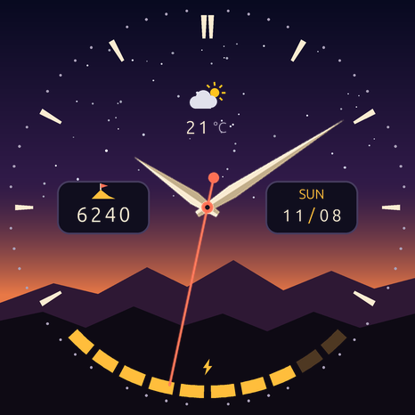

# Horizon



Analog dusk face: a starry night sky fading into a warm orange horizon behind two mountain ridges.

| Position | Element | Live data |
|---|---|---|
| Sky, below 12 | Weather icon (13 conditions, `weather_icons.png`) + temperature | yes (synced from the phone app) |
| 3 o'clock plate | Weekday (gold) over date `MM/DD` | yes |
| 9 o'clock plate | Trail-flag icon + step count | yes |
| Bottom edge | **Battery arc**: 10 golden segments along the rim (fills left → right) + bolt | yes |
| Hands | Cream two-tone dauphine hour/minute hands, coral seconds hand with counterweight (all custom) | yes |

Markers: tapered cream batons (double at 12), dotted minute track; the lower hours give way to the battery arc.

## Files
* `design.py` — generator (colours at the top, positions, icons, hands)
* `horizon.bin` — ready-to-install watch face
* `preview.png` — simulated look (10:09:32, Sun 11/08, 6,240 steps, partly cloudy 21 °C, battery 80 %)
* `weather_icons.png` — the 13 weather icons in watch order

## Rebuild / install
```bash
cd ~/Documents/PROJECTS/oraimo-watch-faces
venv/bin/python -I designs/horizon/design.py
tools/robust_install.sh designs/horizon/horizon.bin      # phone Bluetooth OFF first
```

## Notes
* First design with a custom-drawn **seconds** hand (36×278, 2×10 tiles, pivot (18, 228)).
* Built on the header of store face 1000031; installing replaces the watch's single download slot.
