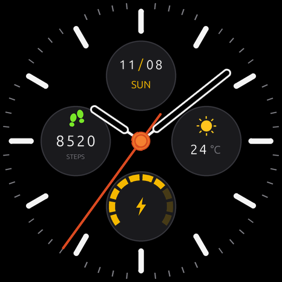

# Meridian Gold (v2)



Analog face inspired by the "meridian" style (black dial, white baton markers, four round sub-dials).
Original artwork, no third-party icons.

| Position | Element | Live data |
|---|---|---|
| Top sub-dial | Date `MM/DD` (gold separator) + weekday (gold, CN/EN chosen by the watch) | yes |
| Left sub-dial | Footprints icon + step count | yes |
| Right sub-dial | Weather icon (13 conditions, see `weather_icons.png`) + temperature (°C/°F) | yes (synced from the phone app) |
| Bottom sub-dial | **Battery ring: 10 golden segments** (0–100 % in 10 % steps) + bolt | yes |
| Centre | Own hour/minute hands (thin stem + white-outlined black "pill"), Oraimo orange seconds hand | yes |

## Files
* `design.py` — generator (colours, positions, icons, hands — edit and re-run)
* `meridian-gold.bin` — ready-to-install watch face
* `preview.png` — simulated look (10:08:36, Sun 11/08, 8,520 steps, sunny 24 °C, 70 % battery)
* `weather_icons.png` — all 13 weather icons, labelled

## Rebuild / install
```bash
cd ~/Documents/PROJECTS/oraimo-watch-faces
venv/bin/python -I designs/meridian-gold/design.py
tools/robust_install.sh designs/meridian-gold/meridian-gold.bin   # phone Bluetooth OFF first
```

## History
* 2026-11-07 v1: date, weekday, steps, heart rate, battery ring; Oraimo hands. Installed and confirmed.
  Needed two builder fixes (opaque-image encoding, `TBUI` end marker).
* 2026-11-08 v2: reference-style hour/minute hands (first custom-drawn hands), hour markers shortened
  (42 → 32 px), weather + temperature replaces heart rate. Installed and confirmed "perfect" by the user;
  v1 backup removed at the user's request.

## Notes
* Built on the header of store face **1000031**; installing it takes the watch's single download slot.
* Hand pivots inside the hand pictures: hour (9, 123), minute (9, 206), seconds (18, 228) — about 7 px
  below what the element record (233 − y) suggests; measured from Oraimo's own hands and confirmed on the watch.
* Weather shows the "?" icon until the phone app has synced a forecast to the watch.
